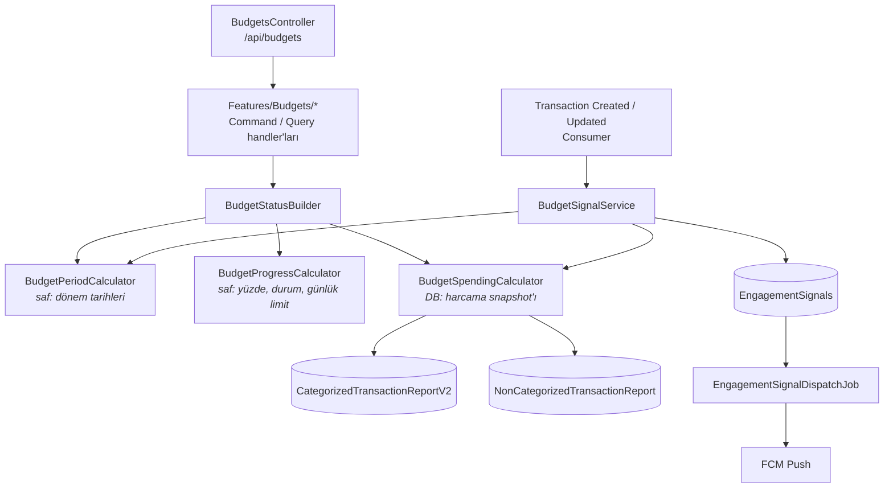
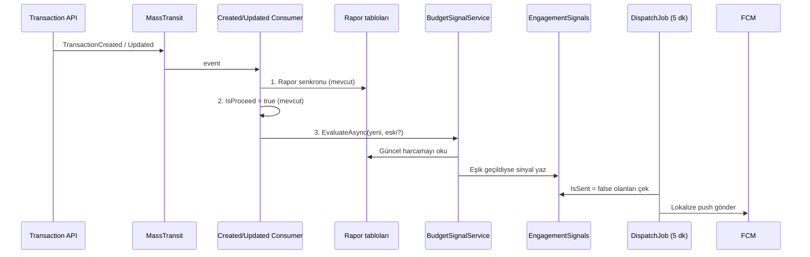

# Bütçe Limitleri: Geliştirme Raporu

| | |
|---|---|
| **Branch** | `feature/budgets` |
| **Tarih** | 15.11.2026 |
| **Kapsam** | Kategori (etiket) bazlı ve genel aylık bütçe limitleri, durum takibi, %80 / %100 push bildirimleri |
| **Durum** | Kod tamamlandı, derleme başarılı (0 hata), migration üretildi. Commit atılmadı, canlı ortamda uçtan uca test edilmedi |

---

## İçindekiler

1. [Özet](#1-özet)
2. [Ürün kararları](#2-ürün-kararları)
3. [Temel tasarım fikri](#3-temel-tasarım-fikri)
4. [Mimari](#4-mimari)
5. [Veri modeli](#5-veri-modeli)
6. [Hesaplama katmanı](#6-hesaplama-katmanı)
7. [API](#7-api)
8. [Bildirim akışı](#8-bildirim-akışı)
9. [Değişen ve eklenen dosyalar](#9-değişen-ve-eklenen-dosyalar)
10. [Tasarım kararları ve gerekçeleri](#10-tasarım-kararları-ve-gerekçeleri)
11. [Doğrulama](#11-doğrulama)
12. [Yayına alma adımları](#12-yayına-alma-adımları)
13. [Bilinen sınırlamalar](#13-bilinen-sınırlamalar)
14. [Sonraki adımlar](#14-sonraki-adımlar)

---

## 1. Özet

Kullanıcılar artık bir etiket için ("Market için ayda 5.000 ₺") ya da tüm giderleri kapsayan **genel** bir aylık bütçe tanımlayabiliyor. Sistem şunları yapıyor:

- Her bütçenin aktif dönemdeki harcamasını, kalan tutarını, yüzdesini ve durumunu hesaplıyor.
- Dönem sonuna kadar **günlük harcanabilir tutarı** gösteriyor.
- Son 1–12 dönemin harcama geçmişini döndürüyor (grafik için).
- Para birimi bazında bir dashboard özeti sunuyor.
- Harcama **%80**'i geçtiğinde ve **%100**'e ulaştığında kullanıcının dilinde push bildirimi gönderiyor.

---

## 2. Ürün kararları

| Konu | Karar |
|---|---|
| Plan kısıtı | **Yok.** Bütçe tüm planlarda sınırsız. `PlanFeatures` enum'una ekleme yapılmadı |
| Periyot | **Yalnızca aylık.** Haftalık periyot kapsam dışı |
| Dönem başlangıcı | Kullanıcı seçiyor: ayın 1–28'i arası bir gün (varsayılan 1) |
| Bütçe türleri | Etiket bütçesi (`UserLabelId` dolu) ve genel bütçe (`UserLabelId = null`) |
| Tekillik | Aynı etiket (veya genel) + para birimi için tek bütçe |
| Bildirim eşikleri | %80 (uyarı) ve %100 (limit doldu) |

---

## 3. Temel tasarım fikri

> **Harcama tutarı hiçbir yerde saklanmıyor. Her istekte mevcut rapor tablolarından hesaplanıyor.**

İlk akla gelen yöntem `Budget` tablosuna bir `SpentAmount` sayacı koyup her işlemde güncellemekti. Bu sayaç şu durumların hepsinde ayrıca düzeltilmek zorunda kalırdı:

- işlem silinmesi,
- tutar güncellenmesi,
- işlemin başka bir aya taşınması,
- etiket değişikliği,
- yeni dönemin başlaması (sıfırlama).

Projede bu senkronizasyonu zaten doğru yapan bir yapı var: `TransactionReportSyncService`. Her işlem rapor tablolarına **günlük toplam** olarak yazılıyor:

| Tablo | İçerik |
|---|---|
| `CategorizedTransactionReportV2` | gün + etiket + para birimi + işlem tipi başına toplam |
| `NonCategorizedTransactionReport` | gün + para birimi + işlem tipi başına toplam (etiketten bağımsız) |

> Not: Alanın adı `Term` olsa da `ReportTerm()` gün başını döndürüyor, yani bucket'lar **günlük**.

Bu yüzden "15 Mart – 14 Nisan arası Market harcaması" sorusu, bu aralıktaki günlük satırların toplamından ibaret. Bütçe tablosu yalnızca bir **limit kaydı** olarak kalıyor ve tutarsızlık riski ortadan kalkıyor.

---

## 4. Mimari



Katmanlar mevcut proje kalıbını izliyor: Domain → Infrastructure (Data / Services / Jobs) → Application (Features / Shared) → API ve Consumers.

---

## 5. Veri modeli

### 5.1 `Budget` (yeni)

`Domain/Entities/Budget.cs`, tablo adı `Budgets`

| Alan | Tip | Açıklama |
|---|---|---|
| `Id` | int | PK |
| `UserId` | int | Bütçenin sahibi |
| `UserLabelId` | int? | Etiket. `null` ise **genel bütçe** |
| `Amount` | decimal(18,2) | Aylık limit |
| `CurrencyId` | int | Para birimi (FK) |
| `PeriodStartDay` | int | Dönemin başladığı gün (1–28), varsayılan 1 |
| `CreateTime`, `IsDeleted`, … | — | `BaseEntity` alanları (soft delete) |

**Index'ler:** `(UserId, CurrencyId, UserLabelId)`, `CurrencyId`, `UserLabelId`

**Neden `PeriodStartDay` en fazla 28?** 29, 30 ve 31 her ayda bulunmuyor. 28 ile sınırlamak şubatta dönemin kaymasını tamamen engelliyor.

### 5.2 `EngagementSignal` (değişti)

- Yeni alan: `BudgetId` (int?, FK → `Budgets`)
- Yeni index: `(BudgetId, Type, OccurredAt)`. "Bu dönem bu bildirim zaten gitti mi?" sorgusunu hızlandırıyor.

### 5.3 Enum'lar

```csharp
// EngagementSignalType (eklenen değerler)
BudgetThresholdReached = 7,
BudgetExceeded = 8

// BudgetStatus (yeni)
OnTrack  = 1,   // < %80
Warning  = 2,   // %80 – %100
Exceeded = 3    // >= %100
```

### 5.4 `BudgetSignalPayload` (yeni)

Sinyalin `PayloadJson` alanına yazılan içerik:

```csharp
public class BudgetSignalPayload
{
    public string LabelName { get; set; }     // genel bütçede null
    public int Percentage { get; set; }       // 80 veya 100
    public decimal BudgetAmount { get; set; }
    public decimal SpentAmount { get; set; }
    public int CurrencyId { get; set; }
    public DateTime PeriodStart { get; set; }
}
```

### 5.5 Migration

`Migrations/20261115204626_AddBudgets.cs`

- `Budgets` tablosu oluşturuluyor (FK'lar `NoAction`).
- `EngagementSignals` tablosuna `BudgetId` kolonu, FK'sı ve index'i ekleniyor.
- Mevcut veriye dokunulmuyor.

---

## 6. Hesaplama katmanı

Hesaplama birbirinden bağımsız üç parçaya bölündü. İkisi **saf** (veritabanı kullanmıyor, kolay test ediliyor), biri veritabanından okuyor.

### 6.1 `BudgetPeriodCalculator` (saf)

`Application/Shared/BudgetPeriodCalculator.cs`

| Metot | Görev |
|---|---|
| `GetPeriod(startDay, asOf)` | `asOf` tarihini içeren dönemi `[Start, End]` olarak döner |
| `GetPeriods(startDay, asOf, count)` | Aktif dönem dahil geriye doğru N dönem (eskiden yeniye) |
| `GetDaysLeft(end, asOf)` | Bugün dahil dönem sonuna kalan gün |

**Kural:** Bugünün günü `startDay`'den küçükse dönem önceki aydan başlar.

| startDay | Bugün | Dönem |
|---|---|---|
| 1 | 15 Kas 2026 | 01 Kas – 30 Kas |
| 15 | 20 Mar | 15 Mar – 14 Nis |
| 15 | 10 Mar | 15 Şub – 14 Mar |
| 10 | 05 Oca 2026 | 10 Ara 2025 – 09 Oca 2026 |

### 6.2 `BudgetSpendingCalculator` (veritabanı)

`Infrastructure/Services/BudgetSpendingCalculator.cs`, arayüzü `IBudgetSpendingCalculator`

İki aşamalı **snapshot** yaklaşımı kullanılıyor:

1. **`LoadAsync(userId, from, to)`** iki sorgu atar. Kullanıcının bu aralıktaki gider satırlarını gün, etiket ve para birimine göre gruplanmış halde belleğe alır.
2. **`snapshot.GetSpent(budget, start, end)`** ek sorgu atmadan toplamı verir:
   - **Etiket bütçesi:** `Categorized` tablosundaki o etiketin satırları.
   - **Genel bütçe:** `NonCategorized` tablosundaki satırlar.

**Neden snapshot?** 10 bütçeli bir listede bütçe başına bir sorgu (N+1) yerine toplam 2 sorgu atılıyor. Bir kullanıcının aylık satır sayısı küçük olduğu için belleğe almak ucuz.

**Neden genel bütçe ayrı tablodan okunuyor?** İki etiketli bir işlem `Categorized` tablosuna iki kez yazılır. Genel bütçe etiket toplamlarından hesaplansaydı bu işlem iki kez sayılırdı. `NonCategorized` tablosunda her işlem bir kez yer alıyor.

### 6.3 `BudgetProgressCalculator` (saf)

`Application/Shared/BudgetProgressCalculator.cs`

Harcanan tutardan DTO alanlarını türetir:

| Alan | Formül |
|---|---|
| `RemainingAmount` | `max(0, Amount − Spent)` |
| `OverAmount` | `max(0, Spent − Amount)` |
| `Percentage` | `Spent / Amount × 100` (100'ü geçebilir) |
| `Status` | `< 80` OnTrack, `80–99` Warning, `>= 100` Exceeded |
| `DaysLeft` | `BudgetPeriodCalculator.GetDaysLeft` |
| `DailyAllowance` | `RemainingAmount / DaysLeft` |

Eşik sabitleri (`WarningThreshold = 80`, `ExceededThreshold = 100`) burada tanımlı. **Hem ekranlar hem bildirimler aynı sabitleri kullanıyor**, böylece "ekranda uyarı görünüyor ama bildirim gitmedi" gibi bir tutarsızlık oluşmuyor.

### 6.4 `BudgetStatusBuilder`

`Application/Shared/BudgetStatusBuilder.cs`

Bütçelerin başlangıç günleri farklı olabilir; biri ayın 1'inde, diğeri 15'inde başlayabilir. Builder:

1. Her bütçenin aktif dönemini hesaplar.
2. Tüm dönemleri kapsayan **en geniş aralığı tek seferde** yükler.
3. Her bütçeyi kendi dönemine göre DTO'ya çevirir.

`GetBudgets` ve `GetBudgetSummary` handler'ları bunu kullanıyor.

---

## 7. API

Base route: `/api/budgets`. Tüm endpoint'ler kimlik doğrulaması istiyor ve yalnızca giriş yapan kullanıcının bütçeleriyle çalışıyor.

| Method | Route | Açıklama |
|---|---|---|
| `GET` | `/` | Bütçeler ve aktif dönem durumları. Opsiyonel `?currencyId=` |
| `GET` | `/summary` | Para birimi bazında özet |
| `GET` | `/{budgetId}?historyCount=6` | Detay ve son N dönemin geçmişi (1–12) |
| `POST` | `/` | Bütçe oluştur |
| `PUT` | `/{budgetId}` | Limit ve başlangıç gününü güncelle |
| `DELETE` | `/{budgetId}` | Sil (soft delete) |

### 7.1 Oluşturma

```http
POST /api/budgets
{
  "userLabelId": 12,        // boş bırakılırsa genel bütçe
  "amount": 5000,
  "currencyId": 1,
  "periodStartDay": 15
}
```

**Kontroller:**
- `amount > 0`, `currencyId > 0`, `periodStartDay` 1–28
- Para birimi mevcut olmalı → yoksa `NotFoundException(Currency)`
- Etiket kullanıcıya ait ya da sistem etiketi olmalı → değilse `NotFoundException(UserLabel)`
- Aynı etiket (veya genel) ve para birimi için bütçe zaten varsa → `AlreadyExistsException(Budget)`

Yanıtta yeni bütçenin `id`'si dönüyor.

### 7.2 Güncelleme

```http
PUT /api/budgets/7
{ "amount": 6000, "periodStartDay": 1 }
```

Etiket ve para birimi **değiştirilemiyor** (gerekçe için [bölüm 10](#10-tasarım-kararları-ve-gerekçeleri)).

### 7.3 Liste ve detay yanıtı (`BudgetDto`)

```json
{
  "id": 7,
  "amount": 5000.00,
  "currency": { "id": 1, "code": "TRY", "symbol": "₺", "...": "..." },
  "label": { "id": 12, "name": "Market", "colorCode": "#4CAF50" },
  "isGeneral": false,
  "periodStartDay": 15,
  "periodStart": "2026-11-15T00:00:00",
  "periodEnd": "2026-12-14T00:00:00",
  "spentAmount": 4012.50,
  "remainingAmount": 987.50,
  "overAmount": 0,
  "percentage": 80.25,
  "status": 2,
  "daysLeft": 30,
  "dailyAllowance": 32.92,
  "history": [
    { "periodStart": "2026-06-15T00:00:00", "periodEnd": "2026-07-14T00:00:00", "spentAmount": 4630.00 }
  ]
}
```

- `history` yalnızca detay endpoint'inde dolu, listede boş dizi.
- Liste sıralaması: genel bütçe en üstte, ardından en çok dolan bütçe.
- Liste **bilerek cache'lenmiyor**: kullanıcı işlem girdikten hemen sonra çubuğun dolduğunu görmeli. Kategori raporu ise 15 dakika cache'leniyor.

### 7.4 Özet yanıtı (`BudgetSummaryDto`)

```json
[{
  "currency": { "id": 1, "code": "TRY", "...": "..." },
  "totalAmount": 20000,
  "totalSpent": 13450,
  "remainingAmount": 6550,
  "budgetCount": 5,
  "onTrackCount": 3,
  "warningCount": 1,
  "exceededCount": 1
}]
```

`totalAmount` ve `totalSpent` için kural: genel bütçe varsa onun rakamları, yoksa etiket bütçelerinin toplamı kullanılıyor. Etiket toplamında çok etiketli bir işlem birden fazla bütçeye sayılabilir; bu durum DTO'da not olarak belirtildi.

---

## 8. Bildirim akışı

Mevcut **Sinyal Motoru**'na bağlandı. Yeni bir job yazılmadı; bildirimler işlem olaylarıyla, harcamanın yapıldığı anda tetikleniyor.



### 8.1 `BudgetSignalService` algoritması

`Infrastructure/Services/BudgetSignalService.cs`

1. İşlem **gider değilse** çıkar.
2. İşlemin etkilediği bütçeleri bulur: aynı para biriminde olup **işlemin etiketlerinden birine ait** olanlar ve **genel bütçe**.
3. İşlem tarihi bütçenin **bu ayki döneminde değilse** atlar. Geçen aya tarihli bir işlem için "bütçeni aştın" bildirimi anlamsız.
4. **Önceki ve sonraki harcamayı karşılaştırır.** Rapor tabloları zaten güncellendiği için `newSpent` doğrudan okunur:

   ```
   oldSpent = newSpent − katkı(işlemin yeni hali) + katkı(işlemin eski hali)
   ```

   `katkı()` fonksiyonu rapor senkronuyla aynı kuralları uyguluyor: gider olmalı, para birimi eşleşmeli, tarih dönem içinde olmalı, etiket eşleşmeli ve silinmiş olmamalı. Böylece **tutar, tarih ve etiket değişikliklerinin hepsi tek formülle** çözülüyor. Yeni eklenen bir işlemde eski hal olmadığı için ikinci terim 0 oluyor.

5. Eşiğin **bu işlemle ilk kez** geçilip geçilmediğine bakar:
   - `old < 100 ≤ new` → `BudgetExceeded`
   - `old < 80 ≤ new` → `BudgetThresholdReached`
   - Tek işlemle iki eşik birden geçilirse (%70 → %105) **yalnızca `BudgetExceeded`** üretilir; arka arkaya iki bildirim gürültü olur.
6. **Tekrar kontrolü:** bu dönemde aynı bütçe ve aynı tip için sinyal zaten varsa yenisi üretilmez. Kullanıcı işlemi silip tekrar eklese ya da tutarı düşürüp yeniden artırsa bile bildirim bir kez gider.
7. **Hata yönetimi:** servis hata fırlatmıyor, logluyor.

### 8.2 Neden hata fırlatmıyor? (kritik)

Consumer'da bir exception oluşsaydı MassTransit mesajı **yeniden denerdi**. Bu durumda rapor senkronu ikinci kez çalışır ve **tutarlar ikiye katlanırdı**. Bu yüzden:

- `EvaluateAsync` kendi içinde `try/catch` yapıp hatayı logluyor.
- Created consumer'da çağrı, `IsProceed` kaydedildikten **sonra** en sona konuldu.

### 8.3 Dispatch job değişiklikleri

`Infrastructure/Jobs/EngagementSignalDispatchJob.cs`

| Metot | Değişiklik |
|---|---|
| `BuildKey` (yeni) | Genel bütçede etiket adı olmadığı için `...General` sonekli ayrı lokalizasyon anahtarları seçiliyor |
| `BuildArgs` | Bütçe case'leri: `{0}` etiket adı, `{1}` yüzde, `{2}` harcanan, `{3}` limit. Tutarlar para birimi sembolüyle biçimlendiriliyor |
| `BuildData` | `budgetId` ekleniyor; mobil uygulama bildirime tıklanınca bütçe detayına gidebiliyor |

### 8.4 Lokalizasyon

`scripts/localizations/notification-localizations.sql` (grup: `ButceYonet.Notification`)

| Anahtar | TR örnek |
|---|---|
| `EngagementSignal.BudgetThresholdReached` | **Bütçe uyarısı: Market** · "Market" bütçende 5.000,00 ₺ limitin 4.012,50 ₺ kadarını harcadın (%80). |
| `EngagementSignal.BudgetThresholdReachedGeneral` | **Bütçe uyarısı** · Aylık bütçende 20.000,00 ₺ limitin 16.100,00 ₺ kadarını harcadın (%80). |
| `EngagementSignal.BudgetExceeded` | **Bütçe limiti doldu: Market** · "Market" bütçende 5.000,00 ₺ limitine ulaştın. Bu dönemki harcaman: 5.240,00 ₺. |
| `EngagementSignal.BudgetExceededGeneral` | **Bütçe limiti doldu** · Aylık bütçende 20.000,00 ₺ limitine ulaştın. Bu dönemki harcaman: 20.450,00 ₺. |

Her anahtarın `.Title` ve `.Body` versiyonları TR ve EN dillerinde mevcut. Metinlerde Türkçe ek uyumu gerektiren kalıplardan ("%80'ine" / "%100'üne" gibi) bilinçli olarak kaçınıldı.

---

## 9. Değişen ve eklenen dosyalar

### Yeni dosyalar (21)

| Katman | Dosya |
|---|---|
| Domain | `Domain/Entities/Budget.cs` |
| | `Domain/Enums/BudgetStatus.cs` |
| Data | `Infrastructure/Data/EntityTypeConfiguration/BudgetEntityTypeConfiguration.cs` |
| | `Migrations/20261115204626_AddBudgets.cs` (+ `.Designer.cs`) |
| Servis | `Application/Interfaces/IBudgetSpendingCalculator.cs` |
| | `Application/Interfaces/IBudgetSignalService.cs` |
| | `Infrastructure/Services/BudgetSpendingCalculator.cs` |
| | `Infrastructure/Services/BudgetSignalService.cs` |
| Shared | `Application/Shared/BudgetPeriodCalculator.cs` |
| | `Application/Shared/BudgetProgressCalculator.cs` |
| | `Application/Shared/BudgetStatusBuilder.cs` |
| | `Application/Shared/Dtos/BudgetDto.cs` (+ `BudgetPeriodDto`) |
| | `Application/Shared/Dtos/BudgetSummaryDto.cs` |
| | `Application/Shared/Profiles/BudgetProfile.cs` |
| Features | `Features/Budgets/CreateBudget/` (Command, Validator, Handler) |
| | `Features/Budgets/UpdateBudget/` (Command, Validator, Handler) |
| | `Features/Budgets/DeleteBudget/` (Command, Validator, Handler) |
| | `Features/Budgets/GetBudgets/` (Query, Handler) |
| | `Features/Budgets/GetBudget/` (Query, Validator, Handler) |
| | `Features/Budgets/GetBudgetSummary/` (Query, Handler) |
| API | `ButceYonet.Api/Controllers/BudgetsController.cs` |

### Değişen dosyalar (11)

| Dosya | Değişiklik |
|---|---|
| `Domain/Entities/EngagementSignal.cs` | `BudgetId` alanı ve `Budget` navigation'ı |
| `Domain/Entities/EngagementSignalPayloads.cs` | `BudgetSignalPayload` |
| `Domain/Enums/EngagementSignalType.cs` | `BudgetThresholdReached`, `BudgetExceeded` |
| `EngagementSignalEntityTypeConfiguration.cs` | Budget FK'sı ve `(BudgetId, Type, OccurredAt)` index'i |
| `Migrations/ButceYonetDbContextModelSnapshot.cs` | EF tarafından güncellendi |
| `ButceYonetModule.cs` | `IBudgetSpendingCalculator`, `IBudgetSignalService` DI kayıtları |
| `DeleteUserLabelCommandHandler.cs` | Etiket silinince bağlı bütçeler de soft delete ediliyor |
| `ButceYonet.Consumers/TransactionCreatedDomainEventConsumer.cs` | `IsProceed` kaydından sonra bütçe değerlendirmesi |
| `ButceYonet.Consumers/TransactionUpdatedDomainEventConsumer.cs` | Rapor senkronundan sonra eski ve yeni halle bütçe değerlendirmesi |
| `Infrastructure/Jobs/EngagementSignalDispatchJob.cs` | `BuildKey`, bütçe `BuildArgs` case'leri, `budgetId` data |
| `scripts/localizations/notification-localizations.sql` | 16 yeni satır (4 anahtar × Title/Body × TR/EN) |

---

## 10. Tasarım kararları ve gerekçeleri

| # | Karar | Gerekçe |
|---|---|---|
| 1 | Harcama saklanmıyor, rapor tablolarından hesaplanıyor | Sayaç tutarsızlığı riski yok; ekleme, güncelleme ve silme senkronu zaten mevcut |
| 2 | Genel bütçe `NonCategorized` tablosundan okunuyor | Çok etiketli işlemler iki kez sayılmıyor |
| 3 | Snapshot ile toplu yükleme | N+1 sorgu yok; liste ekranı bütçe sayısından bağımsız olarak 2 sorgu atıyor |
| 4 | Etiket ve para birimi güncellenemiyor | Dönem geçmişi ve gönderilmiş bildirimler anlamını koruyor; değişiklik için sil ve yeniden oluştur |
| 5 | Tekillik kontrolü kodda, unique index'te değil | MySQL filtreli (`WHERE IsDeleted = 0`) index desteklemiyor ve NULL'ları farklı sayıyor |
| 6 | Bildirimler olay tetiklemeli, zamanlanmış job yok | Bildirim harcamanın yapıldığı anda gidiyor; ek job yükü yok |
| 7 | Yalnızca aktif döneme düşen işlemler bildirim üretiyor | Geçmişe tarihli girişler için anlamsız bildirim gitmiyor |
| 8 | İki eşik birden geçilirse tek bildirim | Gürültü azalıyor |
| 9 | Dönem başına eşik başına tek bildirim | Sil/ekle döngülerinde spam oluşmuyor |
| 10 | `BudgetSignalService` hata fırlatmıyor | Consumer retry'ı rapor tutarlarını ikiye katlamıyor |
| 11 | Eşik sabitleri tek yerde | Ekran durumu ile bildirim davranışı her zaman tutarlı |
| 12 | Saf hesaplar statik sınıflarda | Veritabanı olmadan test edilebiliyorlar |
| 13 | Liste cache'lenmiyor | Bütçe çubuğu işlem girilir girilmez güncelleniyor |

---

## 11. Doğrulama

| Kontrol | Sonuç |
|---|---|
| `dotnet build butce-yonet-api.sln` | Başarılı, **0 hata**. Uyarıların tamamı önceden var olan NuGet güvenlik uyarıları (AutoMapper, NuGet.Protocol) |
| `dotnet ef migrations add AddBudgets` | Başarılı. Migration yalnızca beklenen tablo, kolon, FK ve index'leri içeriyor |
| Dönem hesabı kenar durumları (scratch script) | 8/8 senaryo geçti: ay ortası, başlangıç günü öncesi ve sonrası, tam başlangıç günü, yıl geçişi, şubat/28, yıl sonu, son gün `DaysLeft = 1` |
| Uçtan uca (API, consumer, push) | **Yapılmadı.** Canlı veritabanı ve mesaj kuyruğu ile denenmedi |
| Birim testleri | **Yok.** Projede test projesi bulunmuyor |

---

## 12. Yayına alma adımları

1. Migration'ı uygulayın:
   ```bash
   dotnet ef database update \
     --project src/ButceYonet.Application \
     --startup-project src/ButceYonet.Api \
     --context ButceYonetDbContext
   ```
2. Lokalizasyon script'ini çalıştırın: `scripts/localizations/notification-localizations.sql`
3. Redis'teki lokalizasyon cache'ini temizleyin (`DotBoil:Localization:*`) veya servisleri yeniden başlatın.
4. **API** ve **Consumers** servislerini birlikte deploy edin. Sinyal üretimi Consumers servisinde yapılıyor.
5. Mobil tarafta `type = BudgetThresholdReached | BudgetExceeded` ve `budgetId` içeren push verisi için bütçe detay ekranına yönlendirme ekleyin.

---

## 13. Bilinen sınırlamalar

| # | Sınırlama | Etki | Not |
|---|---|---|---|
| 1 | **Etiketsiz giderler bütçeye sayılmıyor** | Genel bütçe pratikte "etiketli tüm giderler" anlamına geliyor | Rapor tabloları yalnızca `IsMatched = true` (etiketli) işlemleri tutuyor. Mevcut raporlama davranışıyla tutarlı |
| 2 | **Sonradan etiketlenen işlemler yansımıyor** | Etiketsiz girilip sonra etiketlenen işlem ne raporlara ne bütçeye yansıyor | **Bu özellikten bağımsız, önceden var olan bir hata:** `TransactionUpdatedDomainEventConsumer`, işlemin eski hali `IsMatched = false` ise hiç çalışmıyor |
| 3 | Sunucu saati kullanılıyor | Gece yarısına yakın işlemler kullanıcının saat dilimine göre yanlış güne düşebilir | Mevcut raporlar da `DateTime.Now` ve `TransactionDate` ile çalışıyor; saat dilimi ayrı ele alınmalı |
| 4 | Para birimleri dönüştürülmüyor | TRY bütçesi yalnızca TRY giderlerini sayıyor | Döviz kuru özelliği gelince `BudgetSpendingCalculator` güncellenmeli |
| 5 | Eşzamanlı işlemler | Aynı anda işlenen iki işlem nadiren aynı eşik için iki sinyal üretebilir | Kabul edilebilir bir risk; kesin çözüm için sinyal tablosuna unique kısıt eklenebilir |
| 6 | Etiket toplamlı özet | Genel bütçe yoksa özet, çok etiketli işlemleri birden fazla kez sayabilir | DTO'da belgelendi |

---

## 14. Sonraki adımlar

**Kısa vadede önerilen:**
- [ ] Test projesi kurulması; `BudgetPeriodCalculator`, `BudgetProgressCalculator` ve `BudgetSignalService` eşik mantığı için birim testleri
- [ ] [13.2](#13-bilinen-sınırlamalar)'deki güncelleme consumer'ı hatasının düzeltilmesi (raporları da etkiliyor)
- [ ] Commit ve PR

**Ürün olarak sonraki iterasyon:**
- [ ] **Hız uyarısı** (`BudgetPaceWarning`): "Bu hızla ayın 22'sinde limiti aşacaksın". `EngagementSignalJob`'a günlük kontrol olarak eklenebilir
- [ ] **Rollover:** kalan tutarın bir sonraki döneme devri
- [ ] **Bütçe önerisi:** son 3 ayın etiket ortalamasından otomatik limit önerisi (`GET /api/budgets/suggestions`)
- [ ] `GetLandingStats`'a aktif bütçe metriği
